資料科學導論　期末專題報告

# 台北捷運站點人流預測與擁擠預警

第＿組　組員：＿＿＿＿、＿＿＿＿、＿＿＿＿　　2026 年 11 月＿日

<!-- DRAFT-NOTE -->
> 草稿說明：標示【待補】的「觀測 vs 預報天氣」待迴歸工作流以 JMA 預報重跑後補上；第 4.1 節的多月回測目前為歷史期（2024-10～2025-09）尚無天氣特徵的版本，結果產出後更新。
<!-- /DRAFT-NOTE -->

## 一、簡介

**背景與動機**：台北捷運平日日均進站約 229 萬人次，假日約 175 萬人次（假日／平日 = 0.77），而且人流高度集中在少數轉乘站與通勤尖峰（台北車站平均每小時進出站合計約 1.26 萬人次，是第二名西門的 2.2 倍）。遇到豪雨、連假或大型活動時，月台壅塞會降低通勤品質並增加安全風險；目前疏運多依人員經驗與即時監看，屬於事後反應。若能提前一至兩小時預測各站的進出站量，並對「是否擁擠」發出預警，營運單位就能提前調整班距、增派人力或啟動人流管制。

**專案目標**：(1) 預測各站未來 1–2 小時的進站量與出站量（迴歸）；(2) 預測站點未來一小時是否達到擁擠門檻（二元分類），並以逐日回放評估預警的實用價值；(3) 量化雨天、假日、大型活動等因素對人流的影響。期中進度報告已完成 t+1 的基準模型與初步擁擠預警；期末階段依進度報告的六週計畫，補齊外部資料（天氣、活動、颱風假）、t+2 預測、時間序列對照（SARIMA／Prophet）、站型分群、SHAP 解釋、分位數區間、空間特徵、雙門檻擁擠定義與多月回測。另外，補齊兩年天氣資料後，我們更正了進度報告中「假日降雨 > 5 mm 人流降到 55%」的結論（第 2.1 節）。

**提案的預期成果**：(a) t+1、t+2 兩個範圍上，LightGBM 相對 Historical Average 的 MAE 改善 ≥ 25%；(b) 擁擠預警在 Recall ≥ 0.7 下 Precision ≥ 0.9；(c) 報告各站型與雨天情境的表現。三項的達成情形整理在第 4.10 節（表十一）。

## 二、資料集

表一　資料來源

| 資料 | 來源 | 內容與粒度 | 用途 |
|---|---|---|---|
| 每日分時各站 OD 流量 | 臺北大眾捷運公司（政府資料開放平臺 dataset 128506） | 日期、小時、進站、出站、人次；2024-10～2026-09 共 24 個月檔，每月約 300 MB | 聚合成各站每小時進／出站量（目標變數）、OD 流向 |
| 逐時天氣（觀測） | Open-Meteo 歷史再分析（臺北市單一格點） | 氣溫、降雨量、相對濕度；2024-10～2026-09 逐時 17,520 小時，無缺值 | 天氣特徵、雨天分析 |
| 逐時天氣（預報） | Open-Meteo historical forecast：JMA 模式（ECMWF IFS 0.25° 作敏感度分析） | 同上欄位與期間 | 評估「觀測 vs 預報」對預測的影響 |
| 辦公日曆 | TaiwanCalendar（依人事行政總處日曆整理） | 每日是否放假、補班、連假長度、距下一假日天數 | 假日特徵 |
| 大型活動 | 台北大巨蛋、小巨蛋、南港展覽館、台北流行音樂中心、世貿、跨年、大稻埕煙火等官方與維基百科節目表 | 574 筆活動（9 個場館、357 個活動日），含開始／結束時間、估計規模、來源網址 | 活動特徵（站 × 小時旗標與規模）、活動 EDA |
| 颱風停班停課 | 新聞與縣市政府公告 | 5 個停班停課日（2024-10 山陀兒、康芮；2026-07 巴威） | 排除異常日、回測說明 |

**處理流程**（附錄 A）：

- **OD → 站點小時面板**：逐月下載 OD 檔後即時聚合為「站點 × 小時」的進站量與出站量並刪除原始檔（`src/01`）。排除觀察期間內新開通或停用的站點，主研究期（2025-10～2026-09）保留 122 個站名，補齊缺漏時段為 0，共 1,068,720 筆站點小時（`src/02`）；延長回測用的歷史面板（2024-10～2026-09）為 119 個站名、2,084,880 筆。另保留 OD 日流向與各月 OD 分時加總，供空間特徵使用。
- **出站量的定義**：開放 OD 資料只有「進站時段」，因此面板中的出站量 exits(t) 是「在 t 時進站、目的地為該站」的人次，而不是實際走出閘門的時間（全網每小時 Σ進站 = Σ出站）。
- **站名拆分**：景安、大坪林、頭前庄三個轉乘站在 OD 中被拆成「只有進站」與「只有出站」兩個名稱（如 `景安`／`O景安`），環狀線 11 個轉乘口只有進站資料。分群與空間特徵以「實體站」整合這些名稱；迴歸與擁擠標籤則沿用 122 個站名（見第五節限制）。
- **天氣（觀測與預報）**：兩年（2024-10～2026-09）逐時天氣皆取自 Open-Meteo 臺北單一格點。A 工作流發現該格點的「再分析」值與 best_match 預報逐小時相同（都是 ECMWF IFS 9 km 前幾小時預報的拼接），所以本報告的「觀測」其實是高解析度模式分析值，而非測站實測（氣象署測站資料需授權碼，未能取得）。預報因此改用與觀測代理值無關的 JMA 模式：相對觀測的氣溫 MAE 0.92 °C、降雨 MAE 0.27 mm，降雨 ≥ 1 mm 的命中率 0.44、誤報率 0.55；ECMWF IFS 0.25° 的命中率 0.71，但因與觀測同模式家族而偏樂觀，只作敏感度分析。每個小時的預報值大約來自 0–6 小時前發布的預報，視為預測起點可取得（`results/eda_forecast_vs_obs.csv`）。
- **天氣與活動對齊**：天氣以小時對齊目標時段；活動依場館對應鄰近車站（`data/external/venue_station_map.csv`），在開演前 2 小時（到場）與散場起 2 小時（離場）標記 `event_flag` 與 `event_scale`，共 8,322 個站點小時。
- **時間切分**：訓練 2025-10～2026-07、驗證 2026-08（early stopping、選決策門檻）、測試 2026-09（87,840 筆站點小時，平均每站每小時進站 729 人，其中 36 個小時降雨 ≥ 1 mm）。延長回測另以歷史面板做多月滾動起點。

### 2.1 探索性資料分析

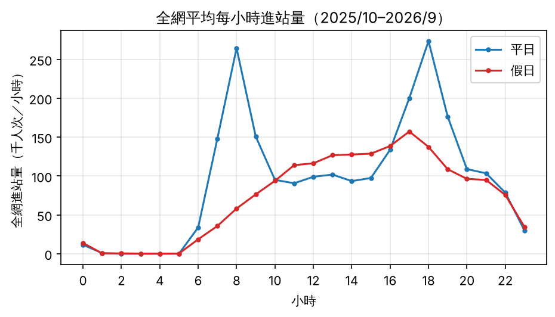{width=11cm}

- **日別與時段**：平日 8 時與 17–18 時為雙尖峰；假日沒有早高峰，日均進站約為平日的 77%。
- **降雨 × 日別**（圖二）：比較同日別、同小時的無雨基準（6–23 時，95% CI 以日為單位做 cluster bootstrap），並排除颱風停班日。兩年資料（2024-10～2026-09）中，中雨（1–5 mm）讓假日全網進站量降到無雨的 93%（CI 0.89–0.97）、平日 97%（CI 0.96–0.99）；降雨 > 5 mm 時平日為 95%（CI 0.91–0.98），假日為 95%（CI 0.83–1.06，只有 25 個小時、13 天），與無雨沒有顯著差異。只看主研究期也一致：中雨時假日 92%、平日 98%。
- **期末更正（雨天效果）**：進度報告「假日降雨 > 5 mm 時人流降到 55%」可以精確重現（主研究期含颱風停班日：0.55，CI 0.28–0.93，21 小時、8 天），但這個數字主要來自巴威颱風停班的週六（2026-07-11）。排除颱風停班日後，主研究期假日 > 5 mm 為 82%（CI 0.70–0.96，只有 13 個小時），兩年資料則是 95%。因此較穩健的結論是：「雨天較抑制非通勤（假日）人流」的方向成立，但幅度比期中報告小，中雨讓假日降約 7–9%、平日降約 2–3%；大雨時的極端下降其實是颱風停班造成，建模時以颱風停班日旗標獨立處理（`results/eda_summary.md`）。
- **大型活動**：大巨蛋活動日，國父紀念館站在開演前的出站量為平日同時段的 3.0 倍、散場時的進站量為 3.9 倍（221 個活動日）；小巨蛋為 2.2 倍與 3.0 倍（133 天）；南港展覽館展覽日約 1.7 倍。
- **颱風假**：停班停課日全網日進站量只剩同類日基準的 8–27%（例如 2026-07-10 巴威颱風為 27%、隔日 10%）。

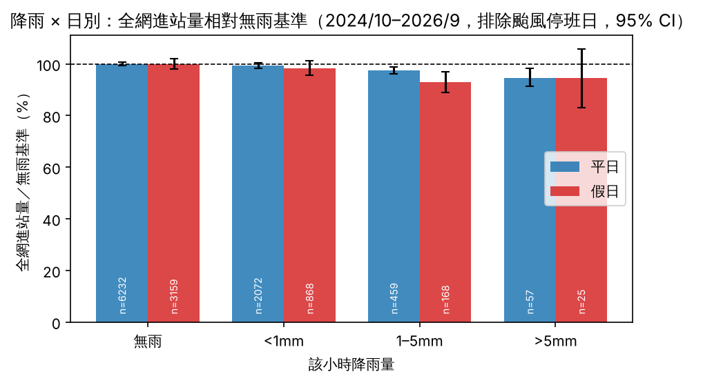{width=10cm}

## 三、方法

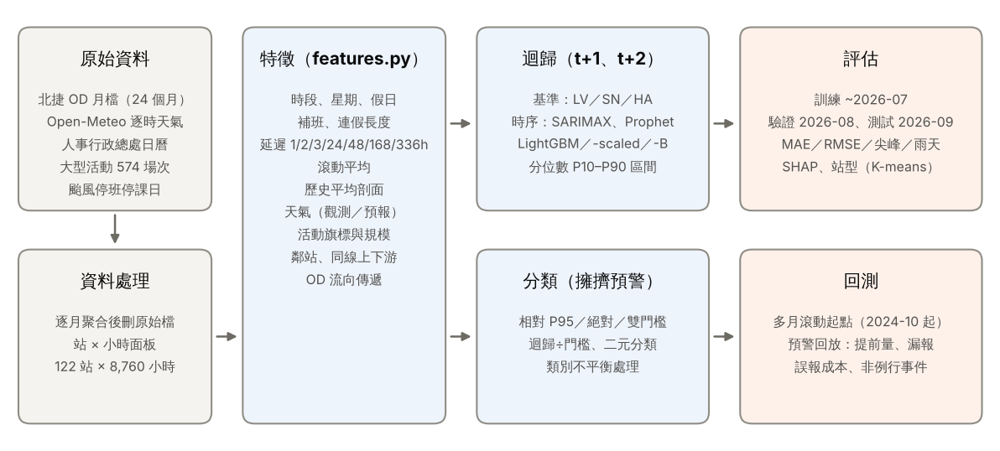{width=16cm}

### 3.1 特徵

所有模型共用 `src/features.py::make_features(panel, target, horizon)`，一列代表（站點，預測起點 t），目標為 y(t+h)，所有特徵只用 t 以前（含 t）可得的資訊：

- **時間與日曆**：目標小時、星期、月份、假日、補班日、連假長度、距下一個／上一個假日的天數。
- **延遲與滾動**：目標序列與另一方向序列的 1／2／3 小時延遲、目標時段的 24／48／168／336 小時前同時段值、24／168 小時滾動平均。
- **歷史平均剖面**：站點 × 平／假日 × 小時的訓練期平均（Historical Average 本身也作為特徵）。
- **天氣**：目標小時的氣溫、降雨、相對濕度（主實驗用觀測值，等同完美預報），以及降雨衍生特徵（降雨開始、前 3 小時累積、雨 × 假日）。
- **活動**：目標站點小時的活動旗標、規模（估計人數）、到場／離場。
- **空間**（第 4.7 節）：鄰站、同線上下游前一小時流量；全網與同線的即時異常比；以各起站目前的異常程度推估其 t+h 進站量，再依 OD 比例傳遞到目的站的「OD 流向」特徵。

### 3.2 模型

- **基準**：Last Value（目前小時）、Seasonal Naive（上週同時段）、Historical Average（站點 × 平／假日 × 小時平均）。
- **時間序列對照**：SARIMAX（√y 尺度，迴歸＋SARIMA(2,0,0)(1,0,0)₂₄ 誤差，外生變數為歷史平均剖面、週期 168 小時的傅立葉項與降雨；參數只估一次，之後以 Kalman filter 逐小時更新）；Prophet（週季節＋平／假日各自的日內季節＋假日與降雨回歸項，每 7 天重估），以及 Prophet+AR（再加上 AR(1) 殘差修正）。122 站 × 進／出站各建一個模型。
- **LightGBM**：全站共用一個模型。「LightGBM」為進度報告第一版（Poisson 損失）；「LightGBM-scaled」把目標除以該站近一週平均量級並以量級加權；「LightGBM-B」為期末改良版，在 scaled 版之外加入站點正規化延遲、依「平日／週六／週日假日」三種日別的歷史剖面、預測起點當下相對剖面的偏離（異常量）、颱風停班停課旗標（前一晚宣布，預測時已知）以及降雨衍生特徵，損失改為 L2。
- **分位數區間**：LightGBM 分位數迴歸輸出 P10／P50／P90，再以驗證月做 split-conformal（CQR）校準。
- **擁擠預警**：(i) 迴歸預測 ÷ 門檻；(ii) LightGBM 二元分類（並比較 class weight、focal loss、欠採樣等不平衡處理）。

### 3.3 評估設計

- **迴歸指標**：MAE、RMSE、平日尖峰 MAE（7、8、17、18 時）、雨天 MAE（目標小時降雨 ≥ 1 mm）與無雨 MAE；跨站型比較時使用「相對 MAE = MAE ÷ 該群平均每小時量」。
- **擁擠定義**：相對門檻＝各站訓練期「進＋出」的 P95；絕對門檻＝全網站時（06–23 時）訓練期 P95 = 5,914 人次／小時；雙門檻＝兩者同時成立。
- **分類指標**：AUC、AP、Precision、Recall、F1。決策門檻一律在驗證集上選「使 Recall ≥ 0.7 的最高門檻」，再套用到測試集，避免偷看測試資料。
- **站型**：以訓練期的平日 24 小時進／出站曲線、假日／平日比、早晚尖峰進出比、量級與是否為轉乘站做 K-means（K=5，另加環狀線轉乘口一群），分站型報告誤差。
- **回測**：(i) 迴歸的多月滾動起點：歷史面板上每個測試月只用之前的資料訓練、每季重訓；(ii) 預警回放：逐小時對每站發出 t+1、t+2 預警，把同站連續擁擠的小時合併為「事件」，統計提前偵測率、提前量、漏報與誤報，測試月包含元旦（2026-01）、春節（2026-02）、清明（2026-04）、端午（2026-06）、巴威颱風（2026-07）與 2026-09。

## 四、結果

### 4.1 迴歸：t+1 與 t+2

表二先重現進度報告的表一（加入天氣後重跑；`results/table1_regression_h1.csv`）：LightGBM-scaled 進站 MAE 41.9、平日尖峰 MAE 77.5，相對 Historical Average（75.9）改善 44.8%。與進度報告（50.0）的差異來自正式版的參數與特徵設定（見 `reference/progress_report/README.md`），而不是天氣：不含天氣的版本為 41.3，兩者整體相近，差異集中在雨天時段（雨天 MAE 72.1，無雨 40.3）。

表二　t+1 小時預測結果：進度報告表一重現（測試集 2026-09，單位：人次）

| 方法 | 進站 MAE | 進站 RMSE | 進站尖峰 MAE | 出站 MAE | 出站 RMSE | 出站尖峰 MAE |
|---|---:|---:|---:|---:|---:|---:|
| Last Value | 272.4 | 597.6 | 786.5 | 271.4 | 639.0 | 802.2 |
| Seasonal Naive | 87.4 | 305.4 | 106.9 | 85.1 | 308.0 | 110.9 |
| Historical Average | 75.9 | 199.3 | 125.3 | 76.5 | 203.5 | 136.2 |
| LightGBM | 42.8 | 120.2 | 90.4 | 41.9 | 117.7 | 96.5 |
| LightGBM (scaled) | 41.9 | 117.6 | 77.5 | 40.2 | 102.8 | 80.7 |

期末主實驗（表三；`results/reg_main.csv`）加入活動特徵並延伸到 t+2。改良版 LightGBM-B 在四個設定上都最好：t+1 進站 MAE 38.5（相對 HA 改善 49.3%）、出站 37.0（51.7%）；t+2 進站 41.6（45.2%）、出站 41.1（46.3%）。從 t+1 到 t+2，LightGBM-scaled 的進站 MAE 增加 11%（41.4 → 46.0），LightGBM-B 只增加 8%（38.5 → 41.6），t+2 的平日尖峰 MAE 也從 88.8 降到 73.6，主要來自「起點當下相對歷史剖面的偏離」這組特徵，讓模型知道今天整體比平常高或低多少。

表三　t+1／t+2 迴歸主結果（測試集 2026-09；MAE 改善 = 相對 Historical Average）

| 目標 | 方法 | MAE | RMSE | 尖峰 MAE | 雨天 MAE | 無雨 MAE | MAE 改善 |
|---|---|---:|---:|---:|---:|---:|---:|
| 進站 t+1 | Historical Average | 75.9 | 199.3 | 125.3 | 129.4 | 73.1 | – |
| 進站 t+1 | LightGBM-scaled | 41.4 | 113.6 | 76.4 | 72.9 | 39.7 | 45.5% |
| 進站 t+1 | LightGBM-B | 38.5 | 106.3 | 68.9 | 60.7 | 37.3 | 49.3% |
| 出站 t+1 | Historical Average | 76.5 | 203.5 | 136.2 | 124.8 | 73.9 | – |
| 出站 t+1 | LightGBM-scaled | 40.4 | 102.6 | 79.5 | 68.1 | 39.0 | 47.1% |
| 出站 t+1 | LightGBM-B | 37.0 | 90.9 | 72.5 | 53.6 | 36.1 | 51.7% |
| 進站 t+2 | LightGBM-scaled | 46.0 | 135.2 | 88.8 | 106.0 | 42.9 | 39.3% |
| 進站 t+2 | LightGBM-B | 41.6 | 119.3 | 73.6 | 67.3 | 40.3 | 45.2% |
| 出站 t+2 | LightGBM-scaled | 47.4 | 133.0 | 97.4 | 118.2 | 43.6 | 38.1% |
| 出站 t+2 | LightGBM-B | 41.1 | 109.2 | 77.7 | 60.3 | 40.1 | 46.3% |

部分站名的另一方向恆為 0（拆名站與環狀線轉乘口），會讓所有方法的整體 MAE 偏低。排除這些全 0 序列後，LightGBM-B 的 t+1 進站 MAE 為 39.5、出站 41.7，相對 HA 的改善比例不變（49.3%、51.7%）（`results/reg_supplement.md`）。

**多月延長回測**（`results/reg_backtest.md`）：為確認結論不是單一測試月的巧合，在 2024-10～2026-09 的歷史面板（119 個站名）上以滾動起點測試 2025-10～2026-09 每個月：每季重訓一次，每次只用該季開始前的資料訓練（前一個月 early stopping），歷史平均也只用該季以前的資料，沒有未來資訊洩漏。注意：2024-10～2025-09 的歷史天氣尚未補齊，因此這一版回測的訓練資料前 12 個月沒有天氣特徵（模型視為缺值），歷史天氣補齊後會重跑更新。

表四　多月滾動起點回測（t+1，2025-10～2026-09，每季重訓；`results/reg_backtest_monthly.csv`、`reg_backtest_special.csv`）

| 項目 | Seasonal Naive | Historical Average | LightGBM-scaled | LightGBM-B |
|---|---:|---:|---:|---:|
| 進站全年 MAE | 95.4 | 83.1 | 46.0 | 40.2 |
| 出站全年 MAE | 94.4 | 84.0 | 44.1 | 39.3 |
| 進站：颱風假（2 天） | 629.9 | 560.6 | 196.9 | 78.9 |
| 進站：春節連假（9 天） | 288.4 | 167.6 | 53.8 | 43.2 |
| 進站：跨年（12/31 18 時–1/1） | 186.0 | 218.5 | 100.4 | 111.6 |
| 進站：一般平日 | 62.2 | 61.7 | 41.0 | 35.8 |

- **12 個月全部達到提案目標**：LightGBM-B 相對 HA 的進站 MAE 改善介於 42.8%（2026-01）與 61.2%（2026-07）之間，主測試月 2026-09 為 51.8%，並不是特別容易的月份。
- **颱風假**（2026-07-10、07-11）：停班停課日的進站量只剩平常的一到三成，HA 與 Seasonal Naive 的誤差高達 560–630；LightGBM-B 靠颱風日旗標與起點異常特徵快速下修，MAE 降到 78.9，但仍偏高估（平均偏差 +66）。
- **跨年**是全年最難的時段：12/31 晚間低估跨年人潮、1/1 凌晨後高估，LightGBM-B（111.6）甚至略遜於 LightGBM-scaled（100.4）。

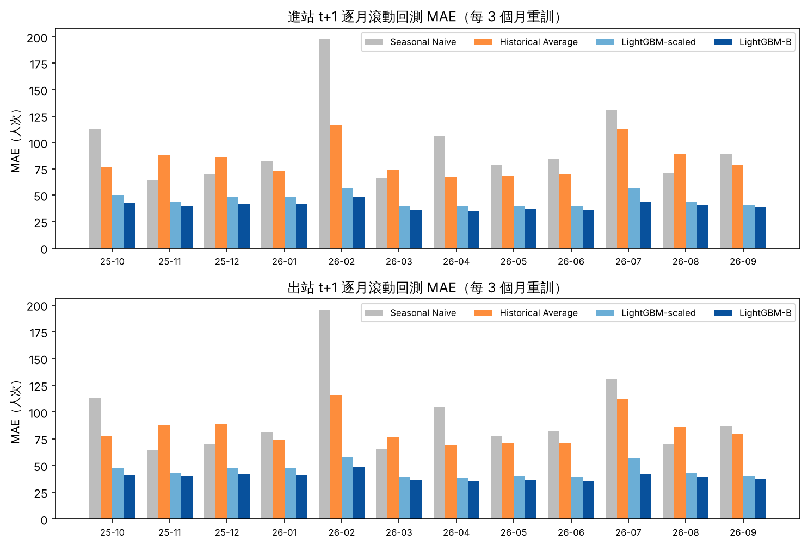{width=11cm}

### 4.2 與 SARIMA／Prophet 對照

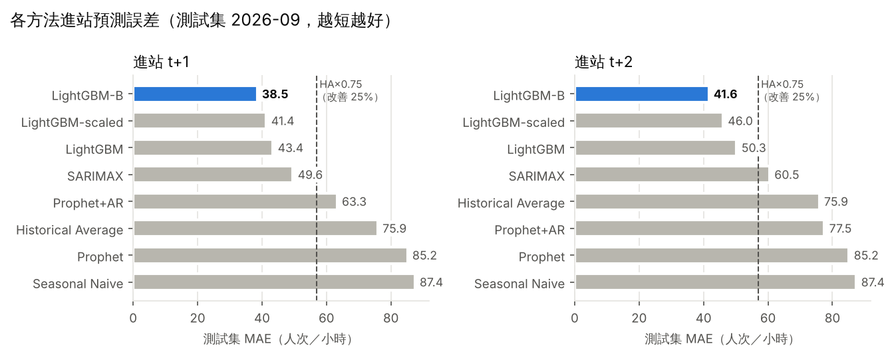{width=15cm}

表五　時間序列模型對照（進站，測試集 2026-09；`results/ts_compare.csv`）

| 方法 | t+1 MAE | t+1 尖峰 MAE | t+1 雨天 MAE | t+2 MAE | 擬合耗時（122 站，單核秒） |
|---|---:|---:|---:|---:|---:|
| Historical Average | 75.9 | 125.3 | 129.5 | 75.9 | – |
| Prophet | 85.2 | 173.7 | 124.6 | 85.2 | 207 |
| Prophet+AR | 63.3 | 174.7 | 91.2 | 77.5 | 207 |
| SARIMAX | 49.6 | 102.2 | 71.0 | 60.5 | 986 |
| LightGBM (scaled) | 41.9 | 77.5 | 72.1 | 46.6 | 全站共用一個模型 |

- **SARIMAX 是很強的傳統基準**：相對 HA 改善 35%，但 MAE 仍比 LightGBM-scaled 高約 18%（t+1）到 30%（t+2）；尖峰 MAE（102）只略優於 Seasonal Naive（107）。單一 SARIMA 結構難以同時描述尖峰的陡升與離峰的平穩。
- **雨天時 SARIMAX 與 LightGBM-scaled 打平**（71.0 vs 72.1）：SARIMAX 的狀態會用最新一小時的實際量自動下修整體水準，等於即時吸收了降雨造成的量級變化。這個觀察促成 LightGBM-B 加入「起點異常量」特徵。
- **Prophet 不適合小時級短期預測**：它只學平滑的季節曲線且不使用最新觀測，MAE 甚至比 HA 差；加上 AR(1) 殘差修正後仍無法改善尖峰。Prophet 較適合中長期的季節分解。
- **成本**：SARIMAX 每個序列需單獨擬合（進、出站 244 個序列合計約 1,864 單核秒），LightGBM 只需一個全域模型（約 1–2 分鐘），新站點也不需另外建模。

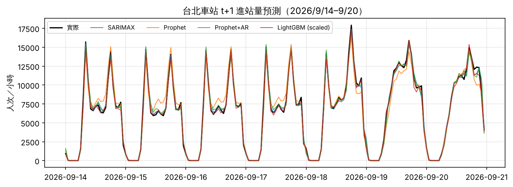{width=14cm}

### 4.3 站型分群與各站型誤差

K-means 的 silhouette 在 K=2–4 最高（0.30–0.32），K≥5 降到約 0.2，代表站型是連續光譜；K=5 是能分出提案中轉乘、辦公、住宅、觀光四類再加一個混合群的最小 K。108 個實體站參與分群，環狀線 11 個轉乘口因沒有出站資料另歸一群。

表六　站型與 LightGBM-scaled 相對 MAE（t+1 進站；`results/cluster_profiles.csv`、`results/cluster_error.csv`）

| 站型 | 實體站數 | 特徵 | 代表站 | 相對 MAE | 尖峰相對 MAE | 較 HA 改善 |
|---|---:|---|---|---:|---:|---:|
| 轉乘樞紐型 | 15 | 量級最大，全為轉乘站 | 台北車站、西門、中山 | 0.047 | 0.038 | 52% |
| 商圈觀光型 | 17 | 假日／平日比最高（0.94） | 市政府、台北101/世貿、士林 | 0.073 | 0.042 | 43% |
| 住辦混合型 | 24 | 早晚尖峰進出混合 | 石牌、松山、南港 | 0.060 | 0.048 | 46% |
| 辦公型 | 15 | 早上出站多（進／出 0.29） | 行天宮、南京三民、港墘 | 0.068 | 0.041 | 36% |
| 住宅型 | 37 | 早上進站多（進／出 4.42） | 新埔、頂溪、淡水 | 0.050 | 0.036 | 43% |
| 環狀線轉乘口 | 11 名稱 | 只有進站資料 | 中和、景平、Y板橋 | 0.114 | 0.084 | 15% |

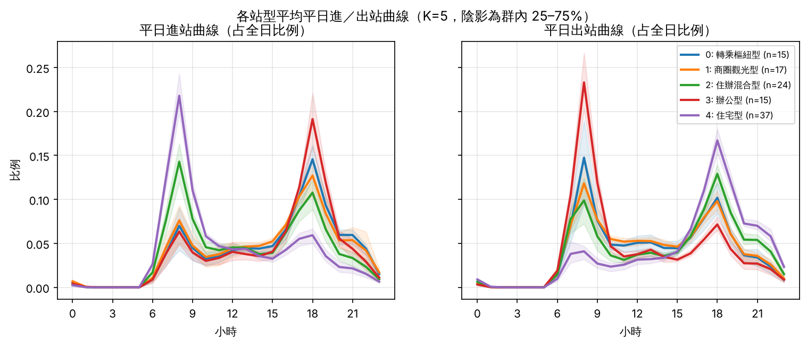{width=14cm}

- **最難預測的是商圈觀光型與辦公型**：前者由休閒與活動驅動，無法從通勤規律推得；後者在假日與連假前後落差最大，LightGBM 相對 HA 的改善也最少（36%）。轉乘樞紐型與住宅型最容易，住宅型的尖峰相對 MAE 只有 0.036。
- **方法排名在每一群都相同**（LightGBM < SARIMAX < 其餘），因此站型差異主要反映「可預測性」本身，而不是某個方法只適合某類站。例外是雨天：住宅型與住辦混合型的雨天／無雨誤差比最高（LightGBM-scaled 1.70、1.49），SARIMAX 在這兩群的雨天誤差較小（0.071 vs 0.083）。
- LightGBM-B 在各站型都比 LightGBM-scaled 再降低 5.5–9.7%，以轉乘樞紐型最多（`results/reg_supplement.md`）。

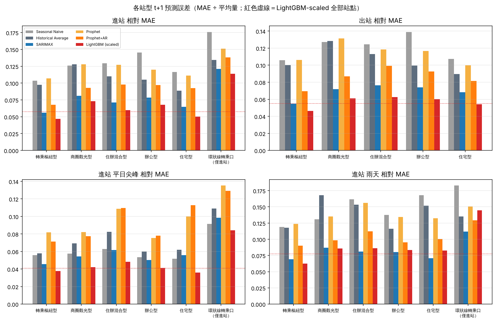{width=14cm}

### 4.4 SHAP 與雨天、假日、活動的影響

以 LightGBM-B（進站 t+1）在測試集抽樣計算 SHAP，並換算成「人次／小時」的加總貢獻後依特徵組彙整（`results/reg_shap_groups.csv`）：歷史平均剖面占平均 |SHAP| 的 69.8%，近期延遲（t、t−1、t−2 與起點異常量）13.6%，週期延遲 9.0%，假日／日別 2.9%，天氣 1.7%，活動 0.2%。單一特徵以「依日別的歷史剖面」最重要（51.6%）。

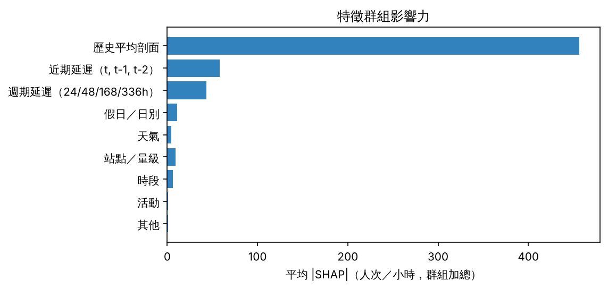{width=11cm}

- **天氣**：天氣的整體貢獻小，拿掉所有天氣特徵後進站 t+1 的 MAE 幾乎不變（38.5 → 38.5），雨天 MAE 只從 60.7 升到 62.8。原因是降雨的影響大多已被「起點當下的異常量」與最新延遲吸收：雨從前一小時就在下時，模型從 y(t) 就能看到量級下修。
- **雨天誤差仍偏高，但約一半是組成效應**：測試＋驗證期（2026-08～09，123 個雨天小時）的雨天 MAE 62.3，無雨 38.1；若把無雨時段依雨天的「站 × 時段 × 日別」組成重新加權，無雨 MAE 升到 49.1，控制組成後雨天／無雨只剩約 1.27 倍。代表雨天誤差高的原因約有一半是「雨多下在白天與大站」，而不是雨本身難預測（`results/reg_rain_tables.md`、`reg_rain_analysis.md`）。真正的雨天誤差集中在兩種情境：平日雨天被低估（平均偏差 −8.3 人次，尖峰時段 −26.9），因為通勤需求剛性、部分騎車或步行者改搭捷運；假日雨天則被高估（+16.9），與 EDA 中「假日降雨抑制人流」的方向一致；持續 4 小時以上的降雨與 ≥ 10 mm／h 的豪雨也系統性高估（+15.6、+42.1）。南港展覽館的雨天誤差最大，但主因是展覽人潮剛好遇到下雨（活動 × 雨天混淆）。
- **假日**：假日／日別特徵的效果集中在平日尖峰時段（假日沒有早高峰），由「依日別的歷史剖面」承擔大部分；補班日與連假長度的貢獻較小。
- **活動**：活動特徵平均貢獻只有 0.2%，因為受影響的站點小時很少（測試月 354 個）。但在這些站點小時上，LightGBM-B 相對 HA 的 MAE 改善為 44%（進站）與 70%（出站），拿掉活動特徵後整體 MAE 只差 0.2（38.5 vs 38.7）。活動站時的絕對誤差仍高（進站 MAE 389），活動規模與散場時間的不確定是主要來源。

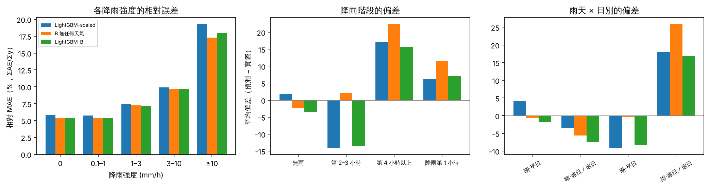{width=16cm}

**觀測 vs 預報天氣**【待補】：主實驗的天氣用觀測值，等同預報完全準確；以「發布於預測起點前的預報值」取代後的 MAE 差異，將由 `results/reg_weather_forecast.md` 補入。在預報資料到位前，可由消融推估這項樂觀偏差的上限：拿掉全部天氣特徵時，進站 t+1 整體 MAE 為 38.47（含天氣 38.48），雨天 MAE 從 60.7 升到 62.8，因此即使預報完全失準，整體 MAE 的差距最多約 0.1、雨天 MAE 最多約 2 人次（`results/reg_ablation.csv`、`reg_summary.md`）。

### 4.5 分位數預測區間

以 LightGBM 分位數迴歸輸出 P10／P50／P90（目標同樣除以站點量級並以量級加權，使 pinball loss 等於原尺度），再以驗證月（2026-08）做 split-conformal 校準（CQR；「分組」= 平日尖峰與其他時段各自校準），名目覆蓋率 80%（表七；`results/reg_quantile.csv`）。

表七　P10–P90 預測區間（測試集 2026-09，分組 CQR 校準；寬度單位：人次）

| 目標 | 覆蓋率（全部） | 覆蓋率（平日尖峰） | 覆蓋率（雨天） | 平均寬度 | 尖峰平均寬度 | P50 MAE |
|---|---:|---:|---:|---:|---:|---:|
| 進站 t+1 | 79.7% | 72.4% | 73.4% | 116 | 224 | 39.7 |
| 出站 t+1 | 79.6% | 73.5% | 73.6% | 112 | 227 | 39.9 |
| 進站 t+2 | 80.4% | 73.3% | 71.8% | 123 | 235 | 42.8 |
| 出站 t+2 | 80.4% | 74.8% | 71.5% | 125 | 249 | 43.3 |

- **整體覆蓋率校準後非常接近 80%**：未校準時出站 t+1 只有 72.0%，CQR 後提升到 79.6%。
- **平日尖峰覆蓋不足（約 72–75%）**，且主要是實際值高於 P90：9 月開學後通勤尖峰比校準用的 8 月（暑假）更高，校準月與測試月的分布不同，分組校準只能部分修正。實務上建議以近 4 週滾動校準，或在開學月加寬區間。
- **雨天覆蓋率約 72–74%**，低於 P10 的比例較高，對應前述假日雨天的高估。

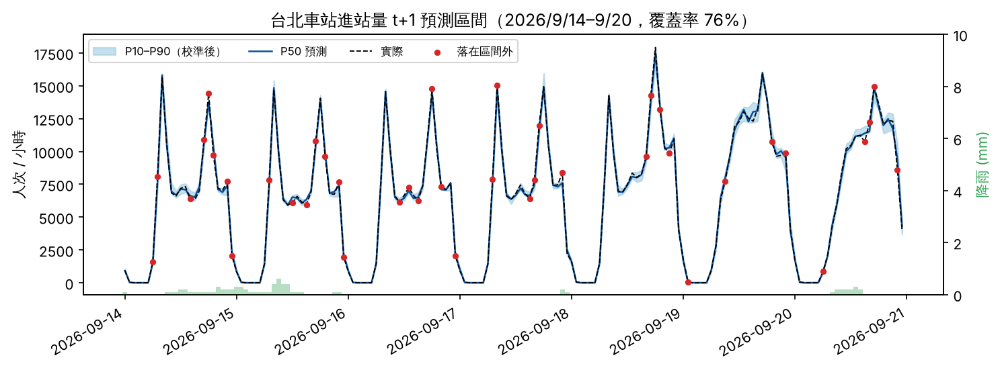{width=15cm}

### 4.6 迴歸結果小結

LightGBM-B 在 t+1 與 t+2 都把 MAE 降到 HA 的一半左右，t+2 的退化很小；SARIMAX 是最強的傳統對照，Prophet 不適合本任務。誤差的主要來源依序是站型（商圈觀光型、辦公型）、活動站時與雨天的平日尖峰。

### 4.7 空間特徵

在 LightGBM-scaled 上逐組加入空間特徵（表八；`results/spatial_ablation.csv`）：

表八　空間特徵消融（LightGBM-scaled 測試集 MAE；括號為相對 base 的變化）

| 目標 | base | +鄰站 | +OD 流向 | +全部 | 雨天 MAE（base → +全部） |
|---|---:|---:|---:|---:|---:|
| 進站 t+1 | 41.74 | 42.67（+2.2%） | 40.46（−3.1%） | 41.06（−1.6%） | 72.3 → 61.0 |
| 出站 t+1 | 40.09 | 40.75（+1.6%） | 38.39（−4.2%） | 37.96（−5.3%） | 66.9 → 54.3 |
| 進站 t+2 | 46.02 | – | – | 43.40（−5.7%） | 104.6 → 66.3 |
| 出站 t+2 | 46.51 | – | – | 42.53（−8.6%） | 103.1 → 62.1 |

- **OD 流向特徵最有用**，對出站與 t+2 幫助最大；t+1 出站模型中 `od_exp_next_rel` 占 62% 的 gain。由於出站量是以進站時段記錄，「已在車上、即將抵達」的人流其實已包含在 exits(t) 中，因此這組特徵的設計是「以各起站目前的異常程度推估 t+h 時的進站量，再沿 OD 比例傳遞到目的站」。
- **雨天誤差大幅下降**：t+2 進站雨天 MAE 從 104.6 降到 66.3。全網／同線的即時異常比能反映下雨或事件造成的整體偏移。
- 單獨加入鄰站原始量反而略差（+2%），與站別強相關的原始量容易過擬合。

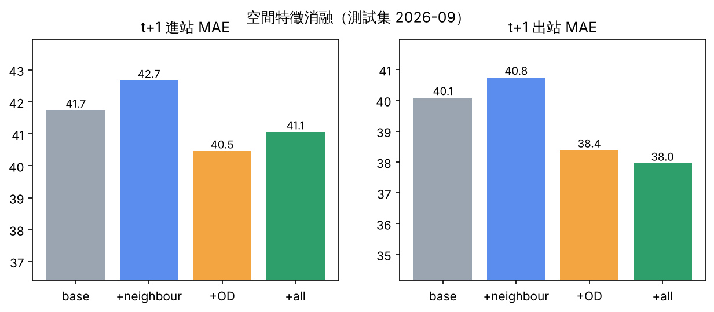{width=12cm}

### 4.8 擁擠預警：雙門檻與類別不平衡

先重現進度報告的表二：相對 P95 定義下測試集正類率 5.71%，HistAvg Precision 0.952／Recall 0.560，LightGBM 二元分類 Precision 0.969／Recall 0.745（報告為 0.961／0.742），差異 ≤ 0.02（`results/clf_table2.md`）。

**雙門檻**：相對門檻把一半以上的正類放在小站（只是小站自己的尖峰：大站 754、中站 1,600、小站 2,662 個站時），絕對門檻則幾乎只剩大站（2,531／807／14）；雙門檻（1.7% 正類）把兩者的缺點排除，聚焦在大、中站的異常尖峰。絕對門檻 5,914 人次／小時約為每分鐘 100 人通過閘門，約相當於單一方向尖峰運能的 1/4，但查無公開的各站月台容量，仍屬資料驅動的門檻。

表九　擁擠預警主結果（基礎＋空間特徵，t+1，測試集 2026-09；門檻＝驗證集 Recall ≥ 0.7；`results/clf_main.csv`）

| 定義 | 方法 | AUC | AP | Precision | Recall | F1 | 達標 |
|---|---|---:|---:|---:|---:|---:|:---:|
| 相對 P95 | HistAvg | 0.995 | 0.937 | 0.952 | 0.560 | 0.705 | ✗ |
| 相對 P95 | LGB 迴歸 ÷ 門檻 | 0.998 | 0.972 | 0.951 | 0.825 | 0.883 | ✓ |
| 相對 P95 | LGB 分類 | 0.998 | 0.973 | 0.965 | 0.773 | 0.859 | ✓ |
| 絕對 | HistAvg | 0.998 | 0.963 | 0.987 | 0.671 | 0.799 | ✗ |
| 絕對 | LGB 分類 | 1.000 | 0.994 | 1.000 | 0.715 | 0.834 | ✓ |
| 雙門檻 | HistAvg | 0.997 | 0.915 | 0.959 | 0.612 | 0.747 | ✗ |
| 雙門檻 | LGB 迴歸 ÷ 門檻 | 0.999 | 0.970 | 0.947 | 0.871 | 0.907 | ✓ |
| 雙門檻 | LGB 分類 | 0.999 | 0.974 | 0.965 | 0.827 | 0.890 | ✓ |

- 三種定義下 LightGBM 分類在 Recall ≥ 0.7 時 Precision 都 ≥ 0.9；HistAvg 在相同規則下 Recall 都不到 0.7。絕對門檻的「迴歸 ÷ 門檻」Recall 為 0.699，差一點達標。
- **類別不平衡處理幾乎沒有差異**：class weight、focal loss、欠採樣的 AP 與無加權相差不到 0.005。正類率 1.7–5.7% 並不極端，且排序（AUC ≈ 0.998）已經很好，加權只是平移機率，而門檻本來就在驗證集上重選；欠採樣丟掉負類資訊，AP 最低。
- 依站點規模（相對門檻、LGB 分類）：Recall 大站 0.79、中站 0.86、小站 0.72，Precision 都在 0.95 以上。

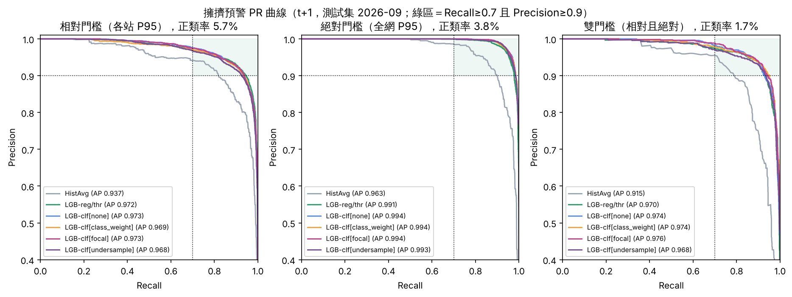{width=14cm}

### 4.9 預警回放回測

逐小時對每站發出 t+1 與 t+2 預警（相對 P95、LGB 分類、基礎＋空間特徵）：目標小時 k 只要 p₁(k−1) ≥ τ 或 p₂(k−2) ≥ τ 就算已預警；同站連續擁擠的小時合併為一個事件，事件開始前就已發出預警才算「提前偵測」。τ 在驗證月以「漏報一個事件 = 10 個誤報小時」的成本最小化選定後，才套用到測試月。每個測試月都以「至前兩個月訓練、前一個月驗證」重新估計門檻與模型；所有月份的訓練與測試都含兩年逐時天氣。測試月涵蓋元旦、春節、清明、端午、巴威颱風（2026-07）與主測試月 2026-09。

表十　預警回放回測（成本比 10:1；`results/clf_backtest.csv`）

| 測試月 | 選定 τ | 事件數 | 提前偵測率 | 平均提前量 | 漏報事件 | 誤報／站／日 | 非例行事件數 | 非例行事件偵測率 |
|---|---:|---:|---:|---:|---:|---:|---:|---:|
| 2026-01（元旦） | 0.225 | 3,695 | 97.8% | 1.97 h | 81 | 0.25 | 234 | 74.8% |
| 2026-02（春節） | 0.2 | 2,223 | 98.9% | 1.97 h | 25 | 0.36 | 175 | 86.9% |
| 2026-04（清明） | 0.25 | 4,016 | 99.3% | 1.98 h | 28 | 0.21 | 411 | 93.9% |
| 2026-06（端午） | 0.225 | 3,673 | 99.2% | 1.98 h | 28 | 0.23 | 178 | 88.2% |
| 2026-07（巴威颱風） | 0.25 | 3,551 | 97.7% | 1.98 h | 82 | 0.22 | 143 | 62.9% |
| 2026-09 | 0.13 | 4,078 | 99.4% | 1.97 h | 24 | 0.26 | 385 | 93.8% |

- **絕大多數擁擠事件是例行尖峰**（約 90% 在歷史平均下就會超過門檻），所以整體提前偵測率很高（97.7–99.4%）；真正考驗模型的是**非例行事件**（活動、天氣、連假前後），偵測率 63–94%，以 2026-07 最低（暑假與活動型態在訓練期較少見）。
- 若改用「小時層級 Recall ≥ 0.7」的保守門檻，誤報降到每站每日 0.01–0.09 次，但提前偵測率只剩 66–89%、非例行事件只剩 6–33%。成本曲線在 τ = 0.1–0.4 之間相當平坦，六個測試月選出的 τ* 都落在 0.13–0.25，建議以此為營運門檻：98–99% 的擁擠事件可提前約 2 小時預警，每站每天約 0.2–0.4 次誤報。
- **春節月誤報最多**（0.36／站／日）：連假期間平日尖峰消失，模型仍依習慣預期尖峰；**元旦月**的非例行事件偵測率偏低（75%），因為訓練資料缺少跨年等罕見型態。
- **颱風停班停課日**（2026-07-10、11；`results/clf_backtest_typhoon.csv`）：這一折的訓練期沒有任何颱風日。兩天內沒有任何站達到擁擠門檻，模型也幾乎不發預警：119 站兩天合計只有 4 個誤報小時（0.017／站／日，同月其餘日為 0.24）。但模型並不知道停班停課公告，預警被壓下來是因為起點時已觀測到的低流量與強降雨；颱風日沒有擁擠事件，因此無法估計颱風日的偵測率。
- **依站型**（2026-09）：商圈觀光型站 385 個非例行事件中占 162 個，誤報最多（0.46／站／日），保守門檻下只有 73% 能提前偵測；辦公型幾乎都是例行通勤尖峰，偵測率 100%、誤報 0.13（`results/clf_backtest_by_cluster.csv`）。

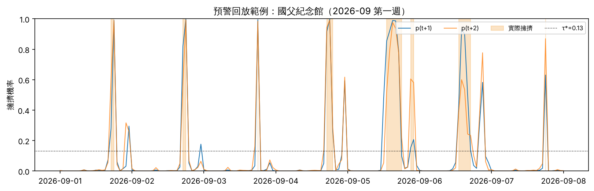{width=15cm}

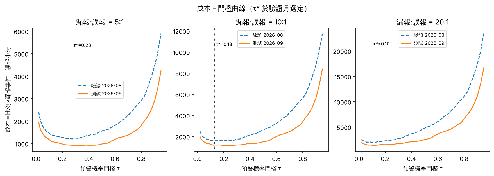{width=15cm}

### 4.10 提案預期成果達成情形

表十一　提案預期成果對照

| 預期成果 | 結果 | 是否達成 |
|---|---|:---:|
| t+1 LightGBM 相對 HA 的 MAE 改善 ≥ 25% | LightGBM-B 進站 49.3%、出站 51.7%（LightGBM-scaled 45.5%、47.1%） | 達成 |
| t+2 LightGBM 相對 HA 的 MAE 改善 ≥ 25% | LightGBM-B 進站 45.2%、出站 46.3%（LightGBM-scaled 39.3%、38.1%）；多月回測 12 個月進站改善 42.8–61.2% | 達成 |
| 擁擠預警 Recall ≥ 0.7 時 Precision ≥ 0.9 | LGB 分類：相對 P95 0.965／0.773、絕對 1.000／0.715、雙門檻 0.965／0.827（Precision／Recall） | 達成 |
| 報告各站型的表現 | 6 個站型的相對 MAE 0.047–0.114，各站型 LightGBM 相對 HA 改善 15–52%；回放回測分站型列出偵測率與誤報 | 完成 |
| 報告雨天情境的表現 | 雨天 MAE 60.7 vs 無雨 37.3（t+1 進站）；約一半為組成效應；空間特徵使 t+2 雨天 MAE 下降 37% | 完成 |
| 延長回測含颱風與連假 | 迴歸多月回測涵蓋 12 個月（含颱風假、春節、跨年；歷史期尚無天氣）；預警回放涵蓋元旦、春節、清明、端午與巴威颱風月 | 完成（颱風日僅 2 天） |

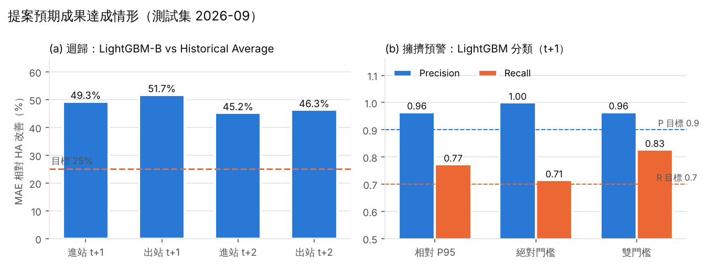{width=15cm}

## 五、討論與限制

1. **出站量不是實際出站時間**：開放 OD 只有進站時段，面板中的「出站量(t)」是「t 時進站、目的地為該站」的人次，不是該站在 t 時實際走出閘門的人數。實際出站時間會依旅行距離延後，因此「出站預測」應解讀為「即將前往該站的人流」，而 OD 流向特徵的設計也據此調整。
2. **17 個站名只代表單一方向**：景安、大坪林、頭前庄在 OD 中拆成只有進站與只有出站的兩個名稱（6 個名稱），環狀線 11 個轉乘口只有進站資料。擁擠標籤沿用 122 個站名以維持與進度報告表二一致，所以這 17 個站名的「進＋出」其實只有單向量，P95 門檻與擁擠標籤只代表「該方向的流量異常」。這些站的另一方向恆為 0，也會讓整體迴歸 MAE 略為偏低（第 4.1 節已列出排除後的數字）。
3. **擁擠是相對定義，不是月台人數**：相對門檻是各站自身歷史的 P95，代表「對該站而言少見的高流量」，不是月台或車廂的實際人數；絕對門檻也只是全網分位數的近似。我們沒有月台面積、列車載客率或轉乘人流（不出站的轉乘旅客在 OD 中看不到），大型轉乘站的月台擁擠可能被低估。
4. **天氣是單一格點的模式值**：所有站點共用臺北市單一格點的 Open-Meteo 降雨，而且這個「觀測」其實是 ECMWF IFS 的高解析度分析值，不是測站實測，無法反映局部午後雷陣雨；主實驗也直接使用目標時段的實際天氣，等同完美預報。實際可用的 JMA 預報對降雨 ≥ 1 mm 的命中率只有 0.44。改用預報值後的實際差異【待補：引用 `results/reg_weather_forecast.md`】；依消融推估，上限約為整體 MAE 0.1、雨天 MAE 2 人次（第 4.4 節），對整體結論的影響有限，但雨天情境的誤差在實際部署時會比本報告略高。
5. **極端降雨與假日的樣本很少**：依進度報告的定義，降雨 > 5 mm 的假日只有 21 個小時（8 天），全網進站比例 0.55 的 95% 信賴區間寬達 0.28–0.93，而且受颱風停班日主導；排除颱風日後兩年資料也只有 25 個小時（CI 0.83–1.06）。大雨對假日人流的影響因此無法定論；測試月也只有 36 個雨天小時，各站型的雨天比較不具統計顯著性。
6. **活動資料不完整**：活動清單以大型場館為主（574 筆），夜市、宗教活動、臨時集會等未納入；EDA 的未列名活動候選檢查顯示南港展覽館、小巨蛋與北流分別仍有 15、11、10 天的異常尖峰找不到對應活動。活動規模多為場館容量的估計值。
7. **測試期與回測涵蓋範圍**：主測試月只有 2026-09；迴歸多月回測與預警回放都涵蓋了 2026-07 的巴威颱風，但颱風停班停課日只有 2 天且沒有擁擠事件，颱風日的預警偵測率無法估計；迴歸回測的歷史期目前也沒有天氣特徵。
8. **停班停課公告尚未成為共用特徵**：迴歸的 LightGBM-B 有颱風停班停課旗標（前一晚宣布即可得知），但共用的 `features.py` 與擁擠分類器尚未使用 `typhoon_days.csv`。分類器在颱風日不發預警，是因為起點時已觀測到低流量，而不是預先知道停班停課；若要在前一晚宣布時就調整預警，需把公告納入共用特徵。

## 六、結論與未來工作

**結論**：

1. 以全站共用的 LightGBM，配合「依站點量級正規化」與「起點當下相對歷史剖面的偏離」等特徵，t+1 與 t+2 的進出站 MAE 都只有 Historical Average 的一半左右，達成提案目標；t+2 的退化很小，代表 1–2 小時的預警窗口在實務上可行。
2. SARIMAX 是很強的傳統對照，雨天時與 LightGBM-scaled 打平，啟發我們加入即時水準修正；Prophet 不適合小時級預測。
3. 站型決定可預測性：商圈觀光型與辦公型最難，轉乘樞紐型與住宅型最容易；方法優劣在各站型一致。
4. 天氣與活動的平均貢獻很小，但在雨天、活動站時與假日的誤差分析中扮演關鍵角色；OD 流向空間特徵使 t+2 的雨天誤差下降約 37%。
5. 擁擠預警在三種定義下都達到 Recall ≥ 0.7 時 Precision ≥ 0.9；回放回測（含颱風月）顯示以成本最小化選定門檻時，97.7–99.4% 的擁擠事件能提前約 2 小時預警，每站每天約 0.2–0.4 次誤報。
6. 更正期中結論：補齊兩年天氣並排除颱風停班日後，大雨並不會讓假日人流減半；穩健的雨天效果是中雨讓假日降約 7–9%、平日降約 2–3%，大雨時的極端下降來自颱風停班。

**未來工作**：

- 取得各站月台面積或列車載客資料，把擁擠門檻換算成實際密度；合併拆名站與環狀線轉乘口為實體站重新定義標籤。
- 改用中央氣象署各測站觀測與鄉鎮逐時預報，評估局部降雨的效果，並把預報誤差納入模型。
- 擴充活動資料（夜市、宗教、集會），並以活動售票數取代場館容量估計。
- 把 SARIMAX 一步預測、分位數區間與站型當成 LightGBM 的特徵（stacking），並把停班停課公告加入共用特徵，讓擁擠預警在前一晚宣布時就能調整。

## 附錄 A　重現步驟

```bash
pip install -r requirements.txt
# 資料管線（約 10 分鐘，需網路；data/processed 已提交，通常不需重跑）
python src/01_download_od.py 2025-10 2026-09
python src/01_download_od.py 2024-10 2025-09
python src/02_build_panel.py
python src/03_calendar.py
# 外部資料與 EDA（工作流 A）
python src/10_weather.py; python src/10_events.py; python src/11_eda.py
# 表一重現
python src/04_baselines_t1.py --horizon 1; python src/04_baselines_t1.py --horizon 2
# 迴歸主模型（工作流 B）
python src/20_regression.py; python src/20_quantile.py; python src/20_shap.py
python src/20_rain_analysis.py; python src/20_weather_forecast.py; python src/20_backtest.py
# 時間序列與站型（工作流 C）
python src/31_clustering.py; python src/30_timeseries.py; python src/32_cluster_error.py
# 空間特徵與擁擠預警（工作流 D）
python src/40_crowd_baseline.py; python src/41_spatial_features.py
python src/42_crowd_main.py; python src/43_alert_backtest.py
# 期末報告與簡報
python src/50_figures.py
python src/50_check_report_numbers.py
python src/50_build_docx.py; python src/50_build_slides.py
```

## 附錄 B　程式與結果對照表

| 程式 | 內容 | 主要輸出 |
|---|---|---|
| src/01_download_od.py | 下載 OD 月檔並聚合 | data/interim/ |
| src/02_build_panel.py | 站點 × 小時面板、OD 日流向 | data/processed/panel_station_hour*.parquet |
| src/03_calendar.py | 辦公日曆 | data/external/calendar.csv |
| src/04_baselines_t1.py | 基準與表一重現 | results/table1_regression_h1.csv |
| src/10_weather.py、10_events*.py | 天氣、活動、颱風假 | data/external/*.csv |
| src/11_eda.py | 雨天／假日／活動 EDA | results/eda_*、figures/eda_* |
| src/20_*.py | 迴歸主模型、分位數、SHAP、雨天分析、預報天氣、多月回測 | results/reg_*、figures/reg_* |
| src/30_timeseries.py | SARIMAX／Prophet 對照 | results/ts_compare.*、figures/ts_example.png |
| src/31_clustering.py、32_cluster_error.py | K-means 站型與各站型誤差 | results/cluster_*、figures/cluster_* |
| src/40–43_*.py | 空間特徵、擁擠分類、預警回放 | results/clf_*、spatial_*、figures/clf_* |
| src/50_*.py | 整合圖、數字檢查、Word／簡報產生 | figures/final_*、report/* |
